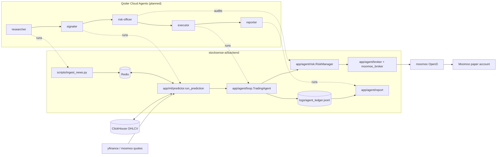

# StockSense Agent: Architecture

Describes the system as built on branch `claude/stock-briefing-panel-vLTiD` (PR #4 plus master).
Items marked *planned* do not exist yet.

## 1. Overview



Each Qoder agent is a thin operator over a repo command; trading logic stays in tested Python.

## 2. Components

| Component | Path | Responsibility |
|---|---|---|
| Data layer | `app/data/fetcher.py`, `app/core/ch_store.py` | OHLCV + indicators: Redis (15 min), then ClickHouse, then moomoo (if connected), then yfinance |
| Prediction | `app/ml/predictor.py`, `app/ml/models/{xgb_model,lstm}.py` | Ensemble signal + confidence + stop suggestion |
| Explain / backtest | `app/services/xgboost_service.py`, `app/services/backtest_service.py`, `scripts/train_model.py` | SHAP, Optuna tuning, walk-forward metrics (binary next-day model) |
| Signal adapter | `app/agent/loop.py: predictor_source` | `run_prediction` to `TradeSignal` |
| Risk gate | `app/agent/risk.py` | Pre-trade checks, sizing, halts, invalidation |
| Broker | `app/agent/broker.py`, `app/agent/moomoo_broker.py` | `Broker` protocol; in-memory sim; Moomoo SIMULATE adapter |
| Ledger | `app/agent/ledger.py` | Append-only JSONL: signal, decision, fill, risk_event, equity; each record carries a `run_id` |
| Report | `app/agent/report.py` | Markdown summary of the latest run, one `--run-id`, or all runs on a `--date` for one `--broker` |
| Agent specs | `qoder/` | Skills + orchestrator (drafts) |

## 3. Cycle sequence

1. `predictor_source` fetches signals (one failing ticker is skipped, not fatal).
2. Broker prices updated; account read; `RiskManager.mark(equity)` updates peak and day baseline; an `equity` record is written.
3. If the kill switch is on or drawdown >= hard limit: flatten all positions, log a `risk_event`, end cycle.
4. Exits first (stop-loss hit or SELL signal); never blocked by the gate.
5. Entries, most confident first. For each BUY: `evaluate_entry` returns approve (with quantity) or reject (with reason); both are logged as `decision`.
6. Approved orders go to the broker; fills are logged; realized PnL on sells feeds invalidation tracking.

## 4. Risk design

Checks run in order for each entry: halt conditions (kill switch, hard drawdown, daily loss,
invalidation), confidence floor, already-held, max positions, price validity, then sizing.
Quantity = floor(min(risk-to-stop size, per-position cap, remaining gross-exposure room, cash)),
halved (risk-to-stop and per-position terms only) when drawdown >= 5%. Limits live in `RiskLimits` (defaults in the PRD).

State that matters: peak equity, day-start equity, list of closed-trade PnLs. With
`--broker moomoo` these are saved to `logs/risk_state.json` after every cycle and restored at
start, so a restart keeps the drawdown halt, daily baseline and loss streak. Delete the file to
reset deliberately. (The in-memory sim broker does not persist, since its account restarts at
$100k.) A closed trade is recorded only when a position reaches zero; partial exits are summed.
Sizing uses a conservative executable price (limit buffer + slippage) and a per-order fee
allowance, and the same effective stop is used for sizing and the order. After exits the
risk state is re-marked before entries, so a loss from an exit can halt same-cycle entries; a
ticker sold in a cycle is not bought back in it, and held positions get their stop checked even
if their signal failed.

## 5. Broker

- `SimBroker`: instant fills with slippage and commission; used for dry runs and tests.
- `MoomooSimBroker`: `OpenSecTradeContext` with `TrdEnv.SIMULATE` fixed. Limit orders priced 20 bps through the *signal price* supplied by the loop (no fresh quote is fetched, so it can be stale); polls up to 20 s, cancels the remainder, supports partial fills. Stops are not native to the flow, so they are tracked locally and saved to `logs/moomoo_stops.json`.
- Both satisfy the `Broker` protocol, so the loop is unchanged between them.

## 6. Data stores

| Store | Used for |
|---|---|
| Redis | Dataset/prediction/sentiment caches |
| ClickHouse | OHLCV + indicators history, news sentiment, backtest results (optional; degrades gracefully) |
| Supabase/Postgres | Auth, user data (app features, not the agent loop) |
| JSONL ledger | Source of truth for the agent's decisions and fills |

## 7. Failure modes

| Failure | Behaviour |
|---|---|
| Signal fetch fails for a ticker | Logged, ticker skipped |
| OpenD unreachable | Broker calls raise; cycle fails loudly (no silent paper/live confusion) |
| Order not filled in time | Cancelled, final fill state re-polled; failures logged as `order_rejected` (buys and sells) |
| ClickHouse down | Falls back to Redis/yfinance |
| Process restart | Stops and risk state persist (Moomoo broker) |
| Risk-state file unwritable | Probed before the first order of each run. Exits and flatten still run; failure is logged (`state_persist_failed`); new entries are blocked until the state can be saved again. A failure from an earlier process also blocks entries until a human reconciles and restarts with `--ack-state-failure` (a lost save can mean a closed loss is missing from the saved history) |

## 8. Known gaps

- **Commission on Moomoo fills is reported as 0 and sell PnL is gross**, because the order API call used does not return fees. Closed-trade PnL, invalidation and win rate are therefore slightly optimistic on the Moomoo path (the sim broker includes costs). Querying fees is a follow-up.
- Invalidation latches until a human resets it (`logs/risk_state.json` for Moomoo; delete the file or `reset_invalidation()`).
- In soft drawdown only the risk and per-position size terms are halved; a binding gross-exposure or cash cap is not halved further.
- The report never mixes brokers: `--date` merges every run of one broker on that day (a paper account is one continuous equity curve; simulator runs each restart at $100k, so they are measured per run with return compounded and drawdown = worst run, and the report says so). Partial-exit PnL for a position closed outside the agent is dropped and logged as `orphaned_partial_pnl`.

See PRD section 8: the model that trades is not the model that is backtested/explained, the
ensemble weights differ from documentation, and the Moomoo adapter is untested against a real
OpenD. Bursa tickers need a Moomoo code mapping.

## 9. Run it

```bash
cd stocksense-ai/backend
python -m app.agent.loop --tickers NVDA --broker sim                # dry run
python -m app.agent.loop --tickers NVDA,AAPL --broker moomoo --market US
python -m app.agent.report --ledger logs/agent_ledger.jsonl > report.md
touch KILL_SWITCH   # in stocksense-ai/backend (anchored path); flatten + halt on next cycle
```
